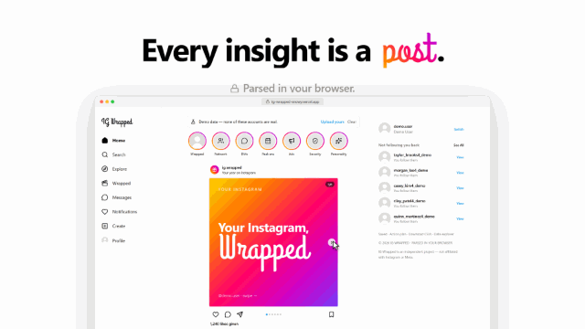

# IG Wrapped

**Your Instagram data export, turned into your own Instagram:** a feed, stories, a profile and a DM inbox, all about you. Who doesn't follow you back, your real ones, your peak era, what advertisers think you're into, and more. It's parsed entirely in your browser, and your ZIP never leaves your device.

**[Try it live →](https://ig-wrapped-snowy.vercel.app)** No export yet? Hit **Try it with demo data**.

<p align="center">
  <a href="https://ig-wrapped-snowy.vercel.app/brag.mp4">
    
  </a>
  <br>
  <a href="https://ig-wrapped-snowy.vercel.app/brag.mp4"><b>▶ Watch the 22-second launch video</b></a>
</p>

Optional accounts let you save your parsed analysis and LinkedIn Helper progress across devices.

## Features

### What's inside

The app is laid out like Instagram itself, in light and dark mode (following your system setting, or the switch under **More**):

- **Home** — A stories row (Story Mode chapters) and a feed of insight posts: your Wrapped carousel, who doesn't follow you back, your Real Ones, peak era, what advertisers think you're into, DM awards, yearbook superlatives, a security check-up and an optional AI recap. Posts can be liked, saved, shared as a card, or asked about with the AI chat.
- **Profile** — Followers, following and mutuals (each opens a searchable list, with "least / most interacted with" sorting), a personality bio, era highlights that play as stories, a yearbook grid, a **People** tab (Real Ones, cleanup with an unfollow planner, leaderboards) and a **Saved** tab for cloud saves.
- **Messages** — An inbox of DMs and group chats. Each chat shows who carries it, chemistry, a timeline, shared links and reels, group roles and an optional AI summary; **Inbox insights** has the monthly chart, heatmap and reply speed.
- **Explore** — Your ad profile as an Explore grid: the ad roast, themed interests, advertisers, ads seen and your feed diet.
- **Search** — Privacy-gated search history (accounts, terms, searches on repeat).
- **Notifications** — Logins, devices and account changes by month, flagged events and connected apps.
- **Wrapped** — Full-screen Instagram-style stories with progress bars and tap / hold controls; names hidden by default.
- **Create** — Upload a new export (drag and drop) or load demo data.
- **More** — Light/dark switch, Presentation Mode, Saved, Tools (Action plan, LinkedIn helper, Compare exports, CSV downloads, Data explorer), log in/out, and clear the current analysis.

### Under the hood

- **One identity graph** — Follows, DMs, likes, comments and story interactions are matched to the same account, so every number about a person agrees everywhere (click anyone to open their detail drawer).
- **Real Ones and cleanup scores** — Relationship strength from 1-on-1 DMs, mutual follows and interactions; cleanup priority goes beyond "doesn't follow back" and protects the people you actually talk to.
- **DM and group chat analytics** — Message share, reply speed, active hours, late-night counts, chat awards and group roles.
- **Eras and content diet** — A monthly timeline labeled by what dominated each month, plus how much you watch versus post.
- **Ads, security and search** — What Instagram's ad profile says about you, login history with a heuristic check for unusual events, and privacy-gated search history.
- **Story Mode and share cards** — Instagram-style stories of your export and downloadable gradient cards, with names hidden by default.
- **Presentation Mode** — A fail-closed screen-sharing mode (under **More**): names, handles, DMs, searches, devices and locations are masked everywhere, and raw-data tools are blocked.
- **Demo Mode** — The whole app with synthetic data, so you can look around without an export.
- **Optional AI** — Per-chat DM summaries (`/api/dm-summary`), an overall recap and a chat (`/api/analysis-chat`) that only sees aggregated metrics. All user-triggered.
- **Tools** — Action plan, LinkedIn helper (manual search links only), compare two exports, CSV downloads and a data explorer showing every file in your export.

## Privacy-first, local-first

IG Wrapped is designed with privacy as the core principle:

- **No Instagram login** — Uses only your official data export ZIP
- **ZIP parsed locally** — JSZip parses JSON in your browser; the raw ZIP is never uploaded automatically
- **Optional cloud save** — Sign in only if you want to save your parsed analysis snapshot
- **No media upload** — Photos and videos from your export are never sent to the cloud
- **No scraping** — Never contacts Instagram or LinkedIn; the only network calls are the optional cloud save (Supabase), optional AI features you trigger (via your configured server-side provider), and opt-in Vercel Analytics. LinkedIn Helper opens manual Google searches
- **No LinkedIn automation** — LinkedIn Helper only opens manual Google search links
- **DM privacy** — Message previews are off by default; Presentation Mode blocks the full DM view while screen sharing
- **AI summaries are opt-in** — DM text is only sent to the AI provider when you click Generate AI Summary for a thread
- **AI chat uses summaries only** — `/api/analysis-chat` receives aggregated metrics, not your raw ZIP or full DM history
- **Search history is sensitive** — Hidden in Presentation Mode; Search Wrapped requires explicit unlock

### What cloud save stores

When you click **Save full analysis**, IG Wrapped stores a parsed snapshot in your Supabase account:

- Follower, following, mutual, blocked and restricted account lists
- Activity counts and computed insights (scores, eras, leaderboards, personality)
- DM thread stats and per-sender message counts — with real names only if chat names are showing (the eye button in Messages) when you save (otherwise threads become "Direct message" and people "Person 1, 2…")
- First-message previews, only if you turned message previews on
- Up to 100 masked DM messages per thread (emails and phone numbers hidden) **only if you opt in** at save time, so new AI summaries work after reloading
- Ad interests and advertiser names; security event types and dates
- Search totals and timeline (not the search terms)
- LinkedIn Helper statuses and notes, generated AI summaries, and export metadata

It does **not** store your original ZIP or media files, full DM message histories, raw search terms, export file paths, login IP addresses, locations or device names, or API keys. Each snapshot is limited to 20 MB, and each account can keep 50.

Older saved analyses without the insights bundle will still load; re-upload and save again to unlock newer insights.

## Tech stack

- [Next.js](https://nextjs.org/) 16 (App Router)
- [TypeScript](https://www.typescriptlang.org/)
- [Tailwind CSS](https://tailwindcss.com/) 4
- [Supabase](https://supabase.com/) — Optional auth & cloud save (`@supabase/supabase-js`, `@supabase/ssr`)
- [JSZip](https://stuk.github.io/jszip/) — ZIP parsing in the browser
- [Framer Motion](https://www.framer.com/motion/) — Animations
- [Recharts](https://recharts.org/) — Charts
- [Lucide React](https://lucide.dev/) — Icons
- [date-fns](https://date-fns.org/) — Date formatting
- [Vercel Analytics](https://vercel.com/analytics) — Optional deployment analytics, disabled by default

## Getting started

```bash
npm install
npm run dev
```

Open [http://localhost:3000](http://localhost:3000) and upload your Instagram export ZIP. The app works fully without signing in.

```bash
npm test                # Regression suite (Vitest)
npm run lint            # ESLint, including React Compiler rules
npx tsc --noEmit -p .   # Type-check
npm run build           # Production build
npm start               # Run the production build
```

If `npm run dev` gets stuck in a reload loop with a Turbopack panic saying
`Next.js package not found`, its on-disk cache is stale — delete
`.next/dev/cache/turbopack` (or all of `.next`) and restart. `npx next dev --webpack`
is a fallback that skips Turbopack entirely.

## Optional Supabase setup (cloud save)

Cloud save is optional. Without Supabase env vars, the app runs in local-only mode.

1. Copy `.env.local.example` to `.env.local`
2. Add your Supabase URL and anon key
3. Run `supabase/schema.sql` in the Supabase SQL Editor
4. Enable email/password auth
5. Restart the dev server

See **[SUPABASE_SETUP.md](./SUPABASE_SETUP.md)** for the full step-by-step guide.

## How to get your Instagram export

1. Open Instagram or Meta Accounts Center
2. Go to **Your information and permissions**
3. Choose **Export your information**
4. Select your Instagram profile
5. Choose **Export to device**
6. Set **Date range** to **All time**
7. Set **Format** to **JSON**
8. Choose **All available information** for the best analytics coverage
9. Start the export and wait for Instagram to prepare the download
10. Download the ZIP and upload it to IG Wrapped

**Recommended:** All time · JSON · All available information · Export to device

## Limitations

- Only JSON files are parsed; media files are counted but not processed (HTML-format exports are rejected with a re-export hint)
- The whole ZIP is read into browser memory — exports of roughly 1.5 GB+ (mostly media) may not open; request a new export with Media quality: Low
- Export formats vary by region and Instagram version — some files may not parse
- Account leaderboards depend on Instagram including account names/URLs in activity JSON
- DM reply-time and hour/day analytics require local message text (stripped from cloud saves)
- Large exports may take a moment to process in the browser
- ZIPs over 512 MB and unusually large decompressed JSON payloads are rejected for browser safety
- Cloud save stores parsed snapshots, not the original ZIP
- Personality and privacy scores are illustrative, based on Instagram's export — not scientific
- LinkedIn Helper requires manual review — it does not find profiles automatically
- Ads and privacy insights use phrasing like "Instagram's export suggests…" to avoid overclaiming

For a public production deployment, add a distributed rate limiter or provider budget in front of the optional paid AI routes. The built-in validation, timeouts, response caps, same-origin checks, and per-instance limits are defense-in-depth, not a substitute for account-level quotas.

## Disclaimer

IG Wrapped is an independent tool and is not affiliated with Instagram, Meta, or LinkedIn. The interface is styled after Instagram for fun, but IG Wrapped never asks for your Instagram password; its optional account is separate. It does not scrape Instagram, scrape LinkedIn, or automate LinkedIn connection requests. Use your export data responsibly.

**Do not commit real Instagram export ZIPs to this repository.** The `.gitignore` excludes `*.zip`, `/private-data`, `/instagram-export`, `/data/private`, and `.env.local`.

## License

Private project — see repository owner for terms.
